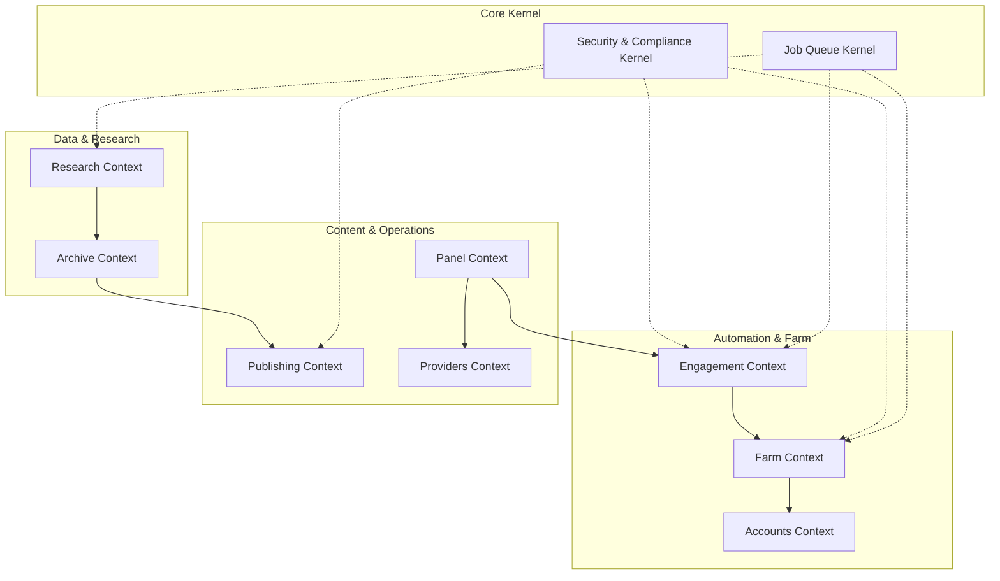

# Bounded Contexts & Domain Architecture

The **tikbot** architecture is partitioned into eight distinct Bounded Contexts following Domain-Driven Design (DDD) principles. This ensures strict isolation between intelligence discovery, farm execution, external providers, and operational safeguards.

---

## 1. Research Context
- **Ubiquitous Language**: Research Run, Prospect, Content Pillar, Outlier Post, Transcript Hook, Competitor Teardown, Trend Metric, Voice of Customer (VOC).
- **Aggregates**:
  - `ResearchRun`: Root entity tracking scope (keyword, author, sound, hashtag), status (`PENDING`, `COLLECTING`, `ANALYZING`, `COMPLETED`), results payload.
  - `ProspectList`: Collection of creators scored by engagement fit, audience resonance, and estimated reach.
- **Domain Services**:
  - `OutlierDetector`: Calculates normalized z-score engagement ratios.
  - `TranscriptMiner`: Extracts claim-hook pairs and sentiment vectors.
  - `CrossPlatformMatcher`: Correlates TikTok handles with X, YouTube, Instagram handles.
- **Emitted Events**: `ResearchRunInitiated`, `ResearchRunCompleted`, `OutlierIdentified`.

---

## 2. Archive Context
- **Ubiquitous Language**: Author, Post, Comment, Sound, Hashtag, Metrics Snapshot, Media Blob, Watermarkless Asset.
- **Aggregates**:
  - `PostArchive`: Root entity holding video metadata, transcription, original URL, clean CDN URLs, and time-series metrics.
  - `AuthorProfile`: Profile details, verified status, bio links, historical post count, velocity.
  - `Watchlist`: Scheduled polling target (creator or search feed) with cadenced fetch triggers.
- **Domain Services**:
  - `UrlNormalizer`: Resolves shortened redirection links (e.g., `vm.tiktok.com`, `vt.tiktok.com`) to canonical video IDs.
  - `MediaArchiver`: Streams video/audio binaries to S3-compatible object storage.
- **Emitted Events**: `PostArchived`, `MetricsSnapshotRecorded`, `MediaAssetDownloaded`.

---

## 3. Accounts Context
- **Ubiquitous Language**: Platform Account, Identity, Session Cookie, Credential Vault, Sticky Proxy, Fingerprint, Device Profile.
- **Aggregates**:
  - `PlatformAccount`: Entity tracking platform (`TIKTOK`, `DOUYIN`, `INSTAGRAM`), username, encrypted credentials, current status (`PENDING_VERIFICATION`, `ACTIVE`, `COOLDOWN`, `BANNED`, `RESTRICTED`), proxy assignment.
  - `Proxy`: Proxy node (IP, port, protocol, credentials, country, latency, health score, active session count).
- **Domain Services**:
  - `CredentialCipher`: AES-256-GCM encryption/decryption of auth tokens and browser cookies.
  - `ProxyRotator`: Assigns healthy, geographically consistent sticky proxies to accounts.
- **Emitted Events**: `AccountRegistered`, `AccountSessionExpired`, `AccountFlaggedBanned`, `ProxyHealthChanged`.

---

## 4. Farm Context
- **Ubiquitous Language**: Farm Pool, Warmup Routine, Fingerprint Seed, Browser Profile, Activity Schedule, Behavioral State.
- **Aggregates**:
  - `FarmProfile`: Execution profile linking an account, browser canvas fingerprint, OS user-agent, and local storage state.
  - `WarmupPlan`: Ordered steps (Day 1: view 10 videos, Day 2: update bio + view 20 videos, Day 3: like 3 videos) with randomized drift.
- **Domain Services**:
  - `FingerprintGenerator`: Synthesizes realistic hardware noise (WebGL, AudioBuffer, Client Hints).
  - `HumanActionSimulator`: Bézier cursor movements, variable scroll friction, randomized typing pauses.
- **Emitted Events**: `WarmupStepCompleted`, `FarmProfileWarmed`, `AnomalyDetected`.

---

## 5. Engagement Context
- **Ubiquitous Language**: Campaign, Action Item, Comment Bank, Viewer Boost Session, Rate Limit, Action Cap, Kill Switch, Manual Approval.
- **Aggregates**:
  - `EngagementCampaign`: Campaign targeting a video/live stream with specific action types (`LIKE`, `COMMENT`, `SAVE`, `SHARE`, `LIVE_VIEW`), target count, speed curve, and approval status (`PENDING_APPROVAL`, `APPROVED`, `REJECTED`, `EXECUTING`, `PAUSED`, `FINISHED`).
  - `CommentTemplate`: Curated library of natural comments categorized by persona and emotion.
- **Domain Services**:
  - `ActionCapEnforcer`: Guarantees hard hourly and daily maximum actions per account.
  - `KillSwitchCoordinator`: Instant global termination of all active browser sessions and background tasks upon emergency signal.
- **Emitted Events**: `CampaignSubmittedForApproval`, `CampaignApproved`, `CampaignEmergencyHalted`, `ActionExecuted`.

---

## 6. Publishing Context
- **Ubiquitous Language**: Content Slot, Media Variant, Scheduled Post, Publish Job, Caption Template, Cloud Browser Uploader.
- **Aggregates**:
  - `PublishJob`: Post payload (video asset, caption, hashtags, mentions, audio tag, scheduled time, target accounts, approval status).
  - `MediaFolder`: Organized hierarchical storage for raw clips, edited cuts, and cover thumbnails.
- **Domain Services**:
  - `ScheduleOrchestrator`: Dispatches publishing jobs based on operator timezones and optimal audience engagement windows.
  - `UploadBridge`: Interacts with TiktokAutoUploader / browser runner to commit uploads.
- **Emitted Events**: `PostScheduled`, `PostPublished`, `PublishFailed`.

---

## 7. Panel Context (SMM Catalog & Orders)
- **Ubiquitous Language**: Service Offering, SMM Order, Tier, Drip Feed, Order Status, Operator Balance.
- **Aggregates**:
  - `ServiceCatalog`: Service definition with unit costs, execution routing (Internal Farm vs External Provider), min/max volume.
  - `Order`: High-level business request for engagement or research services with status lifecycle (`PENDING`, `IN_PROGRESS`, `PARTIAL`, `COMPLETED`, `CANCELLED`).
- **Domain Services**:
  - `OrderRouter`: Decides whether an order is serviced by the local managed farm or dispatched to an external API provider.
- **Emitted Events**: `OrderCreated`, `OrderRouted`, `OrderCompleted`.

---

## 8. Providers Context
- **Ubiquitous Language**: External Provider, API Adapter, Endpoint Contract, Balance Probe, External Task ID.
- **Aggregates**:
  - `ProviderConfig`: API endpoint, encrypted API key, rate limits, status check interval.
  - `ProviderTransaction`: Maps internal order ID to external provider order ID with sync logs.
- **Domain Services**:
  - `SmmProviderAdapter`: Standardized bridge conforming to standard SMM v2 protocol.
  - `BalanceMonitor`: Periodically polls external balance and triggers low-credit notifications.
- **Emitted Events**: `ProviderDispatched`, `ProviderStatusSynced`, `ProviderBalanceLow`.
