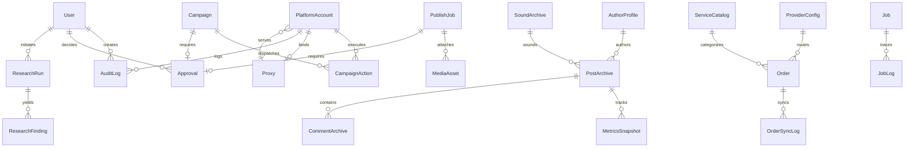

# Prisma ERD & Migration Plan

This document details the relational data model for Tikbot across all bounded contexts.

## 1. Entity Relationship Diagram (ERD)

---

## 2. Model Specifications

### Core / System Kernel
- **`User`**: Admin single operator record with salted/hashed credentials and role.
- **`AuditLog`**: Append-only compliance log capturing operator actions, IP, timestamp, resource, and diff.
- **`Approval`**: Explicit manual authorization gate for campaigns, publishing jobs, and account creation batches.
- **`Job`**: Postgres-backed persistent queue row with `FOR UPDATE SKIP LOCKED` claim fields (`status`, `priority`, `runAt`, `lockedAt`, `lockedBy`, `attempts`, `maxAttempts`, `lastError`).
- **`SystemSetting`**: Key-value pair store for dynamic system configuration, notably `kill_switch_active`.

### Farm & Accounts
- **`PlatformAccount`**: Managed farm account (`platform`, `username`, `encryptedPassword`, `encryptedCookies`, `status`, `healthScore`, `actionsToday`, `dailyCap`, `lastActiveAt`, `proxyId`).
- **`Proxy`**: Residential/mobile proxy definition (`protocol`, `host`, `port`, `username`, `encryptedPassword`, `country`, `latencyMs`, `status`, `healthScore`).
- **`FingerprintProfile`**: Device profile specifications (user agent, viewport dimensions, WebGL vendor/renderer strings, audio noise seeds).

### Archive & Intelligence
- **`AuthorProfile`**: Creator metadata (`platformId`, `handle`, `nickname`, `avatarUrl`, `followerCount`, `videoCount`, `verified`, `bio`).
- **`PostArchive`**: Scraped video record (`platformPostId`, `authorId`, `caption`, `musicId`, `mediaStorageKey`, `coverStorageKey`, `viewCount`, `likeCount`, `commentCount`, `shareCount`, `outlierScore`, `transcriptText`, `publishedAt`).
- **`MetricsSnapshot`**: Time-series progression of views, likes, shares, comments for velocity calculation.
- **`CommentArchive`**: Scraped public comments with sentiment, pain point, and objection tags.
- **`SoundArchive`**: Trending audio tracks and usage counts.
- **`ResearchRun`**: Research investigation container (`type`, `targetQuery`, `status`, `rawPayload`, `summaryReport`).

### Engagement & Campaigns
- **`Campaign`**: Coordinated engagement task (`title`, `targetUrl`, `actionType`, `targetCount`, `executedCount`, `status`, `approvalId`, `startedAt`, `finishedAt`).
- **`CampaignAction`**: Individual atomized interaction assigned to a specific farm account with randomized delay and completion receipt.
- **`CommentBank`**: Pre-approved comment pool organized by sentiment and persona.

### Publishing & Content
- **`MediaAsset`**: Stored binary asset (`storageKey`, `mimeType`, `fileSizeBytes`, `checksumSha256`, `durationSeconds`).
- **`PublishJob`**: Scheduled publishing task (`accountId`, `mediaAssetId`, `caption`, `scheduledAt`, `status`, `approvalId`).

### SMM Panel & External Providers
- **`ServiceCatalog`**: Available action types, unit costs, min/max limits, fulfillment type (`INTERNAL_FARM` vs `EXTERNAL_PROVIDER`).
- **`Order`**: Client or operator SMM order (`serviceId`, `targetLink`, `quantity`, `status`, `providerId`).
- **`ProviderConfig`**: Third-party API credentials, balance thresholds, webhook secrets.

---

## 3. Migration Plan

Migrations will be managed strictly via Prisma Migrate:
1. **`0_init`**: Core tables (`User`, `SystemSetting`, `AuditLog`, `Job`, `Approval`).
2. **`1_accounts_proxies`**: Farm foundations (`Proxy`, `PlatformAccount`, `FingerprintProfile`).
3. **`2_archive_intelligence`**: Data layer (`AuthorProfile`, `SoundArchive`, `PostArchive`, `MetricsSnapshot`, `CommentArchive`, `ResearchRun`).
4. **`3_campaigns_publishing`**: Action execution (`Campaign`, `CampaignAction`, `CommentBank`, `MediaAsset`, `PublishJob`).
5. **`4_panel_providers`**: SMM catalog and integration (`ServiceCatalog`, `Order`, `ProviderConfig`, `OrderSyncLog`).
