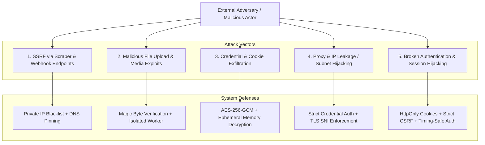

# Threat Model & Security Architecture

This threat model identifies high-risk attack surfaces within Tikbot and details specific technical mitigations.

---

## 1. Server-Side Request Forgery (SSRF)

### Risk Profile
The operator or incoming webhooks provide arbitrary URLs to download TikTok videos, Douyin feeds, or audio streams. A malicious input could target `http://169.254.169.254` (cloud metadata), `http://localhost:5432` (Postgres), or internal Railway private endpoints (`*.railway.internal`).

### Mitigations
1. **URL Validation & Host Whitelisting**:
   - Parse and strictly allow only known platform domains: `tiktok.com`, `*.tiktok.com`, `douyin.com`, `*.douyin.com`, `v.douyin.com`, `bilibili.com`.
2. **Private IP Resolution Guard**:
   - Resolve DNS IP before dispatching any HTTP request.
   - Reject any IP belonging to private RFC-1918 ranges (`10.0.0.0/8`, `172.16.0.0/12`, `192.168.0.0/16`), loopback (`127.0.0.0/8`), or link-local (`169.254.0.0/16`).
3. **Redirect Disabling / Controlled Following**:
   - Limit redirect chains to a maximum of 3 hops and re-evaluate IP filters on each hop.

---

## 2. Media Upload & Binary Storage Abuse

### Risk Profile
Operators or external workers upload video and audio files. Attackers could attempt polyglot file uploads, zip bombs, or malformed MP4 containers targeting ffmpeg buffer overflows.

### Mitigations
1. **Magic Byte Validation**: Validate binary signatures (`ftypisom`, `ftypmp42`, `ID3`, `RIFF/WAVE`) rather than relying on HTTP `Content-Type` headers.
2. **Strict File Size Constraints**: Enforce a hard 500MB limit for video files and 50MB for audio files in reverse proxy and stream reader.
3. **Sandboxed Processing**: All media transcode or thumbnail generation routines (ffmpeg) run in low-privilege isolated worker containers without root privileges.
4. **Non-Executable Storage**: S3/R2 storage buckets reject execution permissions; downloaded media is served with `Content-Disposition: attachment` or strict CORS headers.

---

## 3. Credential & Cookie Leakage

### Risk Profile
Farm accounts store active session cookies, auth tokens, email/SMS provider credentials, and proxy passwords. A database dump or log leak could compromise all assets.

### Mitigations
1. **Envelope Encryption with AES-256-GCM**:
   - Master key `MASTER_ENCRYPTION_KEY` loaded exclusively from environment variables (never committed to repository).
   - Each secret is encrypted with a unique 96-bit initialization vector (IV) and includes an authentication tag to prevent tampering.
2. **Zero-Log Redaction**:
   - Automated logger interceptor scrubs sensitive keys (`password`, `cookies`, `token`, `secret`, `proxyPassword`) from all log pipelines.
3. **In-Memory Volatility**: Decrypted session cookies are held in memory only for the duration of the browser automation run and are discarded immediately afterward.

---

## 4. Proxy Misuse & IP Leakage

### Risk Profile
Misconfigured browser processes might bypass the proxy tunnel and reveal the Railway host's direct IP, triggering immediate rate limits or account flagging.

### Mitigations
1. **Fail-Closed Browser Launch**:
   - Playwright/Patchright instances are launched with mandatory `--proxy-server` arguments.
   - Before any TikTok page navigation, a preliminary check queries `https://api.ipify.org` through the browser session to verify the external IP matches the expected proxy IP.
2. **DNS Leak Prevention**: Browser configurations force DNS resolution through the SOCKS5/HTTP proxy tunnel rather than using local container resolver.

---

## 5. Broken Authentication & Session Hijacking

### Risk Profile
Since Tikbot controls high-value social media accounts and scraping pipelines, unauthorized access to the admin dashboard grants complete control over campaigns and proxies.

### Mitigations
1. **Single-Operator Auth**:
   - Argon2id / bcrypt password hashing with unique salt.
   - Timing-safe password comparisons (`crypto.timingSafeEqual`) to prevent timing side-channel attacks.
2. **Session Security**:
   - Signed, encrypted HTTP-only session cookies with `SameSite=Strict` and `Secure` flags.
   - Absolute session timeout (8 hours) and idle timeout (1 hour).
   - Instant session invalidation upon password update or kill switch trigger.
