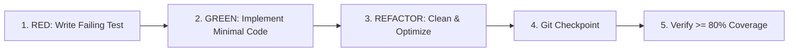

# Test-Driven Development (TDD) Strategy & Verification Protocol

## 1. Core Principles & Mandates

Tikbot enforces an uncompromising **Test-Driven Development (TDD)** lifecycle across all phases.

1. **No Code without a Test**: No functional domain code, API handler, or utility may be authored without a pre-existing failing test asserting expected behavior and edge cases.
2. **80% Line & Branch Coverage Threshold**: The CI pipeline and pre-commit checks fail if total project coverage or any core module falls below 80%.
3. **Evidence Artifacts**: Each development phase generates an evidence log in `docs/tdd/phase-X-evidence.md` documenting test execution results, coverage metrics, and git commit hashes.

---

## 2. Testing Pyramid & Test Types

| Level | Scope | Framework / Tools | Speed Target |
|---|---|---|---|
| **Unit Tests** | Domain rules, cipher cryptography, config validation, outlier math, URL parsing, action caps. | Vitest (`vitest run --coverage`) | < 10ms / test |
| **Integration Tests** | Prisma database queries, queue locking (`SKIP LOCKED`), REST endpoints, S3 storage abstraction, auth session handling. | Vitest + Testcontainers / Postgres local instance | < 250ms / test |
| **Mocked E2E Tests** | Approval workflows, campaign execution states, kill-switch activation, external provider webhooks. | Vitest / Supertest / Playwright Test | < 2s / flow |

---

## 3. The 3-Step Execution Cycle

### Step 1: RED (Failing Test)
- Create `src/**/__tests__/*.test.ts`.
- Declare test cases covering standard operation, null/undefined inputs, boundary conditions, and error rejection.
- Run `npm test` and assert the test fails for the expected reason (e.g. `function undefined`, `schema mismatch`).
- Commit checkpoint: `test(scope): add failing tests for [feature] (RED)`.

### Step 2: GREEN (Minimal Implementation)
- Write the minimal application code in `src/**` to satisfy the test assertions.
- Do not write speculative or extraneous logic.
- Run `npm test` and verify that all assertions pass cleanly.
- Commit checkpoint: `feat(scope): implement [feature] to satisfy tests (GREEN)`.

### Step 3: REFACTOR (Architectural Polish)
- Clean code readability, extract shared constants, enforce typing, and optimize performance.
- Ensure all tests still pass without regressions.
- Verify coverage report via `vitest run --coverage`.
- Commit checkpoint: `refactor(scope): polish implementation and maintain coverage (REFACTOR)`.

---

## 4. Critical E2E Test Flows

The following flows must be maintained in automated suites:
1. **Kill Switch Emergency Interruption**: Assert that activating the kill switch aborts running jobs and blocks any new browser or network actions.
2. **Campaign Manual Approval Lifecycle**: Assert that a created campaign cannot execute until an explicit approval record with status `APPROVED` is granted by the operator.
3. **Action Velocity Cap Enforcement**: Assert that dispatching actions beyond hourly/daily limits triggers account cooldown and rejects further requests.
4. **Encrypted Secret Roundtrip**: Assert that credentials saved to database are encrypted and can only be decrypted with the valid master secret.
5. **Postgres Queue Concurrency**: Assert that 5 concurrent worker processes claim jobs with `FOR UPDATE SKIP LOCKED` without double-claiming or deadlocking.
