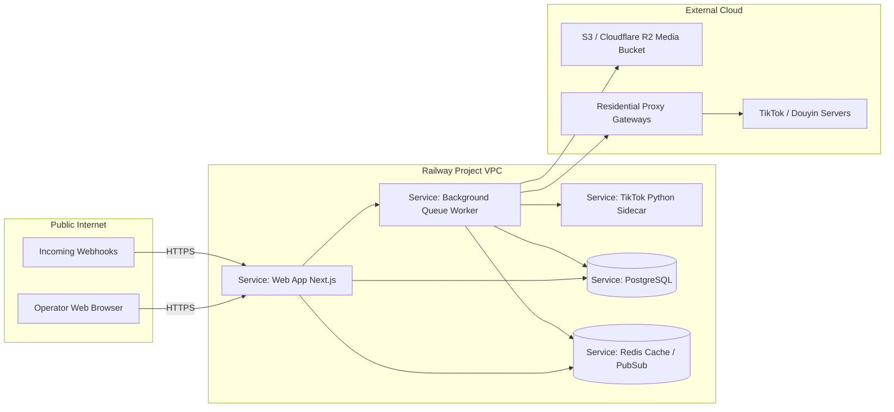

# ADR-002: Railway Multi-Service Deployment Topology

## Status
Accepted

## Context
Tikbot combines interactive web UI, long-running browser processes (Playwright/Patchright), asynchronous background jobs (scraping, transcribing, warmup loops), and database services. Deploying everything into a single monolithic serverless or ephemeral container causes connection drops, memory exhaustion from headless browsers, and queue starvation.

## Decision
We deploy Tikbot on **Railway** utilizing a multi-service architecture within a single private project network:

### Components
1. **Web App (`web`)**: Next.js service running on port 3000. Handles UI, auth, approvals, OpenAPI endpoints. Auto-scales horizontally if needed.
2. **Background Worker (`worker`)**: Standalone Node.js process running the queue processor loop. Has Playwright dependencies installed and sufficient memory (2GB–4GB) to run controlled browser automations.
3. **Python Sidecar (`sidecar-py`)**: Lightweight FastAPI/Python 3.12 container hosting `TikTok-Api` and custom signing routines.
4. **Managed PostgreSQL**: Relational data store for all entities, audit logs, and queue items.
5. **Managed Redis**: In-memory store for distributed rate limits, session invalidation, and real-time dashboard events.

## Consequences
- Private Railway service networking (`*.railway.internal`) ensures internal sidecar endpoints and databases are never exposed to the public internet.
- Browser resource spikes in `worker` do not degrade UI responsiveness in `web`.
