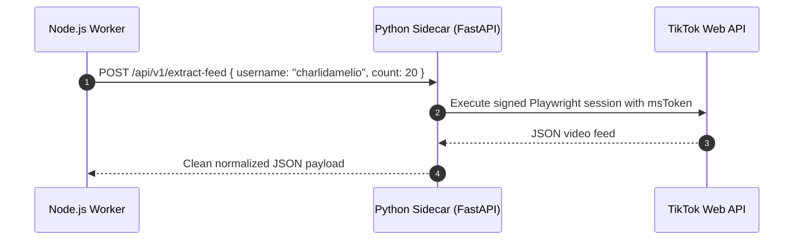

# ADR-005: Python and Node Sidecar Bridges

## Status
Accepted

## Context
TikTok scraping and automation tooling is fragmented across different ecosystems:
- Python hosts the most resilient dynamic signing and Playwright wrappers (`TikTok-Api`, `yt-dlp`, Whisper AI).
- Node.js / TypeScript hosts our main Next.js dashboard, Prisma ORM, and high-performance Web APIs.
- Go and C++ host specific signing binaries, but adding too many language runtimes introduces operational instability.

## Decision
We standardize on a **TypeScript core orchestrator** with a **dedicated Python 3.12 micro-sidecar**:
1. **Core Platform (TypeScript/Node.js)**: Runs Next.js, Prisma, queue worker, compliance engine, and lightweight scraping bridges (`Douyin_TikTok_Download_API` HTTP client, `tiktok-scraper`).
2. **Python Sidecar (`sidecars/tiktok-py`)**:
   - Packaged as a Docker container running FastAPI with Uvicorn.
   - Wraps `TikTok-Api`, Whisper audio transcription pipeline, and custom signature headers.
   - Communicates with the core Node.js worker via internal HTTP REST contracts secured by a shared `INTERNAL_API_SECRET` token.
   - Strict timeout controls (15s connection, 45s execution) to prevent hung worker threads.

## Consequences
- Clean separation of concerns: Node.js worker never suffers native C++/Python build failures or segfaults during npm installs.
- Sidecar can be scaled or restarted independently on Railway if browser memory leaks occur.
